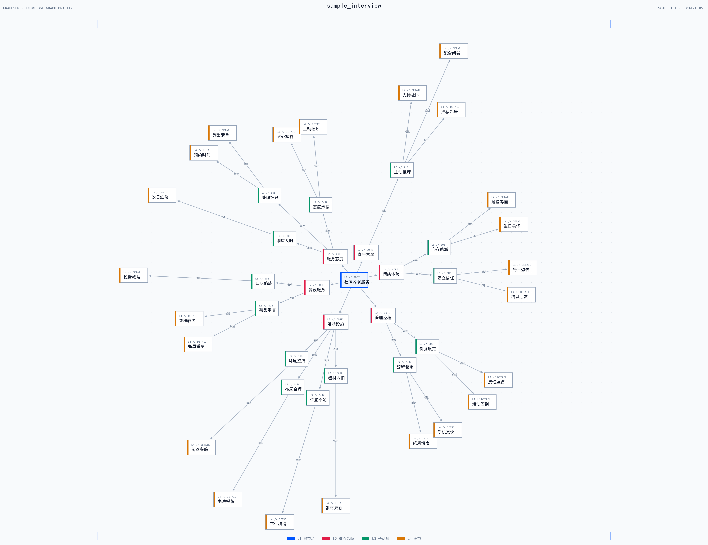
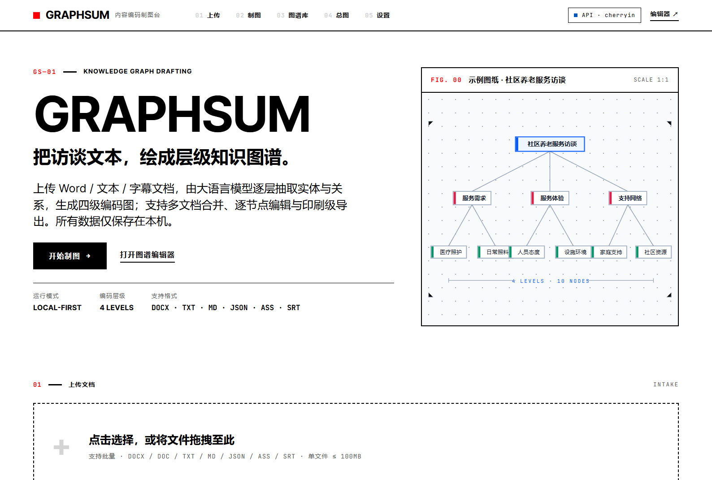
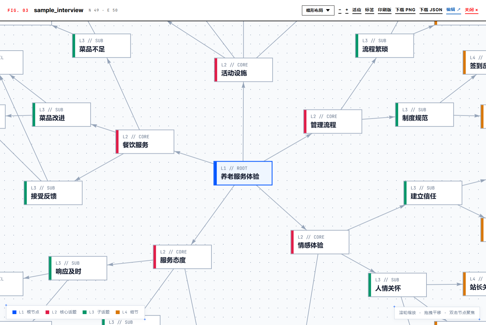
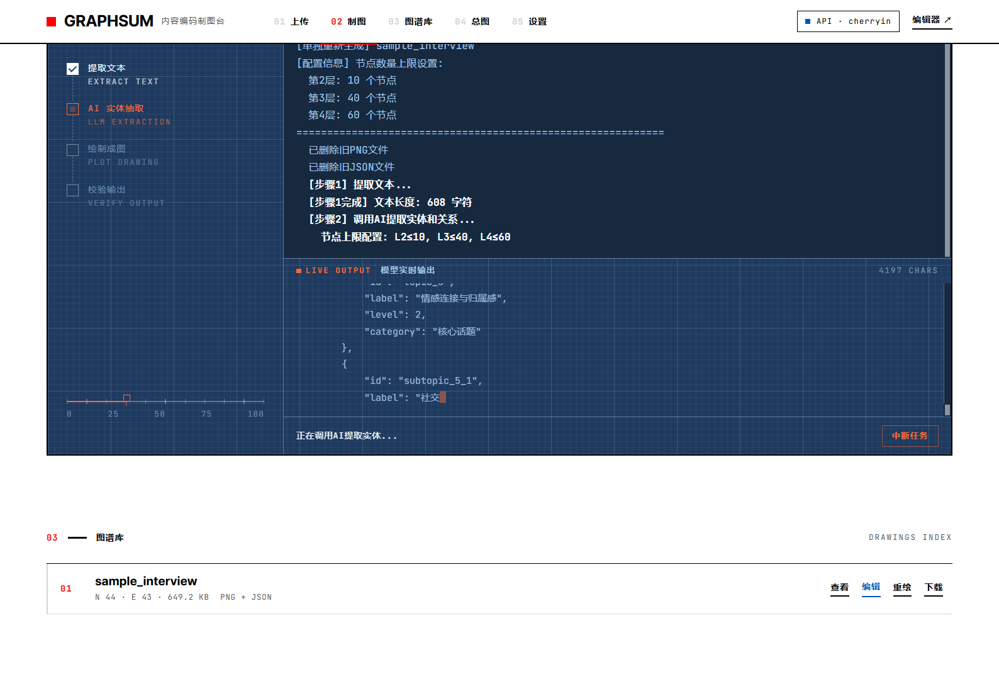
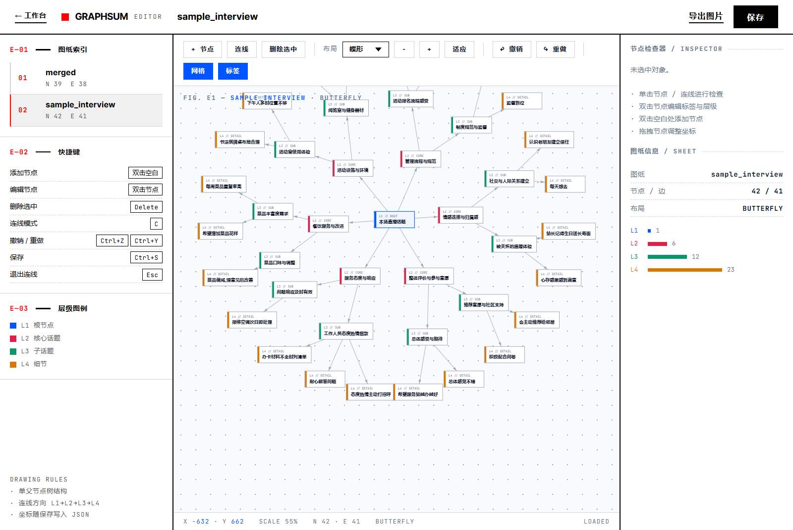

# GraphSum — 访谈文本 → 层次化知识图谱

[English](README_EN.md)

LLM 驱动的访谈/文档知识图谱工具：多格式文本 → 四层实体图谱 → 多文档合并 → Flask Web 编码界面。适用于质性研究编码、业务访谈沉淀、知识库结构化等场景。



*上图为合成样例（`examples/sample_interview.txt`，人物情节均虚构）经真实 API 抽取生成的四层图谱。*

## 功能特性

- **多格式输入**：`.docx`（含表格）、`.doc`、`.txt`、`.md`、`.json`、`.ass`、`.srt`
- **多服务商配置**：任意 OpenAI 兼容服务商，通过环境变量配置，仓库不含任何密钥
- **四层层次图谱**：主题 → 类别 → 表现 → 描述，严格单父节点树形结构，节点数量上限可配置
- **长文本分段**：超过阈值自动分段抽取、重叠拼接、结果合并
- **两级清洗预处理**：规则过滤 + 可选 Reranker 评分筛选，面向直播字幕等噪声文本
- **多文档图谱合并**：按层 AI 语义合并、去重、节点上限约束，生成总编码图
- **Web 编码界面**：上传、批量生成、SSE 实时进度、任务取消、服务商/提示词切换、图谱编辑器（JSON 编辑 + 重新出图）
- **布局算法**：辐射状 / 蝶形两种布局，自动避免节点重叠，交叉检测，含单元测试
- **显式失败**：API 调用或解析失败时明确报错，不生成预设/虚构图谱

## 快速开始

```bash
python -m venv .venv
# Windows: .venv\Scripts\activate   Linux/macOS: source .venv/bin/activate
pip install -r requirements.txt

cp .env.template .env   # 填入你自己的 API 密钥
python app.py           # 打开 http://127.0.0.1:5001
```

在 Web 界面上传 `examples/sample_interview.txt`（或 `.docx` 版本），选择服务商与提示词模板（默认 `interview`），点击生成即可复现上方样例图。

### 命令行模式

```bash
python interview_graph_generator.py   # 1=单文档 2=批量
```

将 `.docx` 放入 `data/`，或用 `TEST_FILE_PATH` 指定单个文件。输出为同目录下的 `*_graph.png` 与 `*_graph.json`。

## Web 界面



- 文件上传与列表、批量子图生成、总编码图合并
- SSE 流式日志与进度、任务取消
- 服务商切换、提示词模板管理（`default` / `interview` / `danmaku` / `article` / `livestream`）
- Reranker 预处理开关与参数





### 图谱编辑器



`/editor` 页面可直接编辑图谱 JSON（增删节点/边、改标签），保存后一键重新渲染 PNG，适合人工编码校正。

## 配置说明

所有配置走环境变量（`.env`，已被 gitignore）。复制 `.env.template` 后按需填写：

```bash
DEFAULT_PROVIDER=openai               # 默认服务商
PROVIDER_OPENAI_API_KEY=你的密钥
PROVIDER_OPENAI_BASE_URL=https://api.openai.com/v1
PROVIDER_OPENAI_MODEL=gpt-4o-mini
```

- 服务商格式为 `PROVIDER_{NAME}_API_KEY / _BASE_URL / _MODEL`，可任意扩展；模板预置 OpenAI 官方示例，任何 OpenAI 兼容服务（含自建网关）按同样格式添加即可
- `SECRET_KEY`：Flask session 密钥，可选；不设置时每次启动随机生成
- `ENABLE_RERANKER_PREPROCESS` / `RERANKER_*`：字幕噪声清洗开关与 Reranker 配置
- `DEFAULT_MAX_LEVEL2/3/4_NODES`：各层节点数量上限
- `FLASK_DEBUG=true`：开发时启用调试模式（默认关闭，仅监听 127.0.0.1）

## 多文档合并

`merge_graphs.py` 加载 `data/` 下全部 `*_graph.json`，逐层调用 LLM 做语义合并与去重，强制单父节点约束与节点上限，输出 `merged_graph.png/json`。Web 界面一键触发，适合多份访谈的总编码图。

## 清洗预处理

`text_preprocessor.py` 对 `.ass/.srt` 字幕先做规则过滤（语气词、纯数字、欢迎/感谢礼物等噪声模式），启用 Reranker 时再按相关度保留高分句子，压缩送入 LLM 的文本量。未启用时原文透传。

## 代码导读

| 模块 | 职责 |
|---|---|
| `app.py` | Flask 路由、任务线程、SSE、上传/合并/编辑器 API |
| `interview_graph_generator.py` | 文本解析、分段、LLM 抽取、图清洗、出图 |
| `merge_graphs.py` | 多子图加载、逐层 AI 合并、节点映射 |
| `text_preprocessor.py` | 分句、规则过滤、Reranker 筛选 |
| `graph_layout.py` | 辐射/蝶形布局、重叠避免、交叉检测、渲染 |
| `logger_config.py` | 日志与流式输出 |
| `prompts.json` | 可切换提示词模板（运行时可在界面编辑） |

## 测试

```bash
python -m unittest discover -v
```

覆盖布局无交叉、抽取失败显式报错、图清洗、分段、合并去重、预处理规则（无需 API 密钥）。

## 隐私与合规

- 仓库只含工具代码与**合成样例**，不含任何真实访谈数据
- `data/`、`logs/`、`.env` 均被 gitignore，不会进入版本库
- 抽取失败显式报错，不以预设结构冒充抽取结果

## 许可证

[MIT](LICENSE)