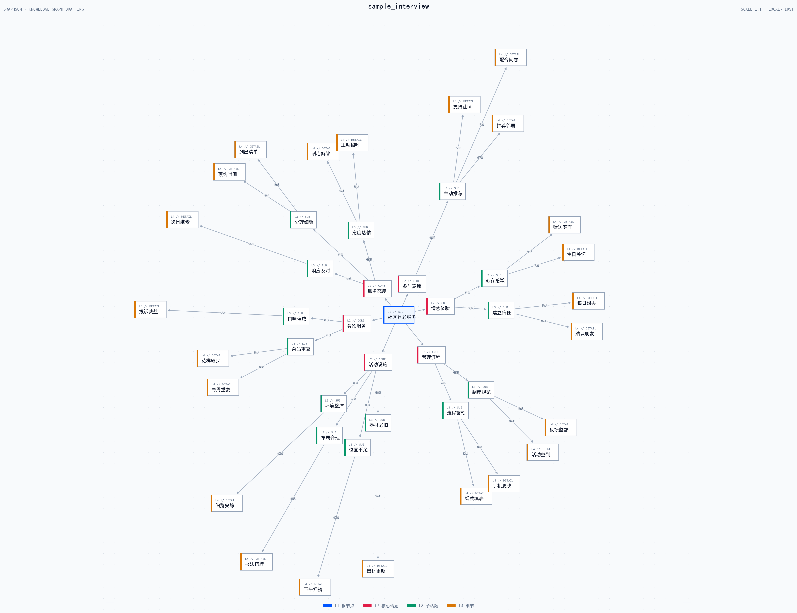
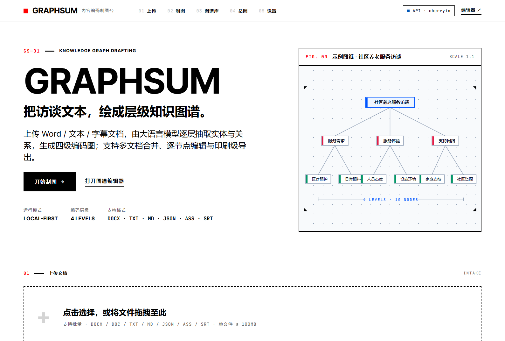
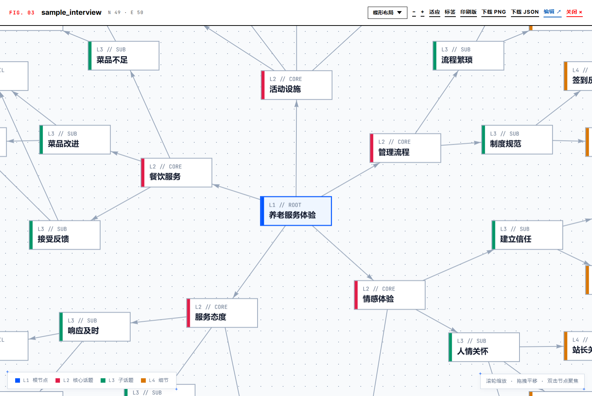
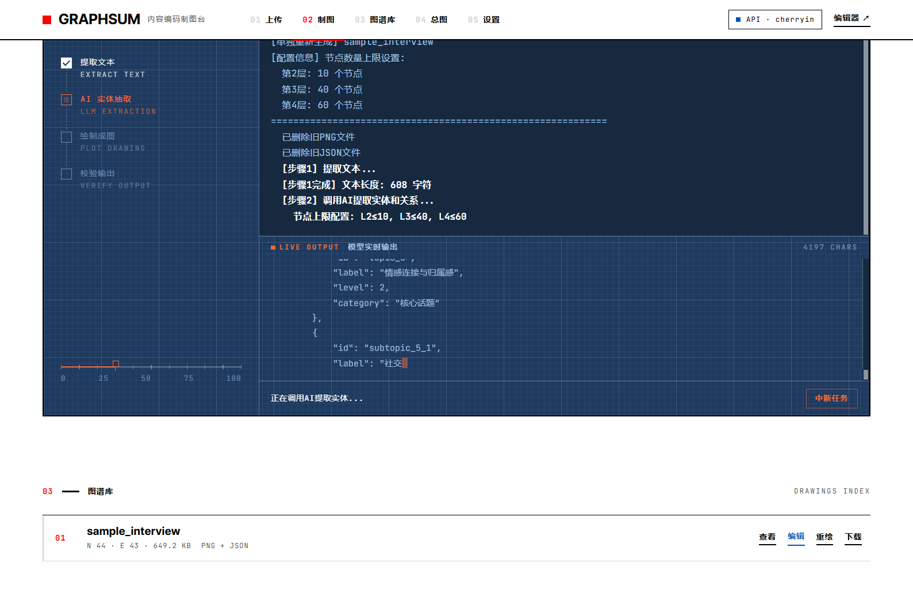
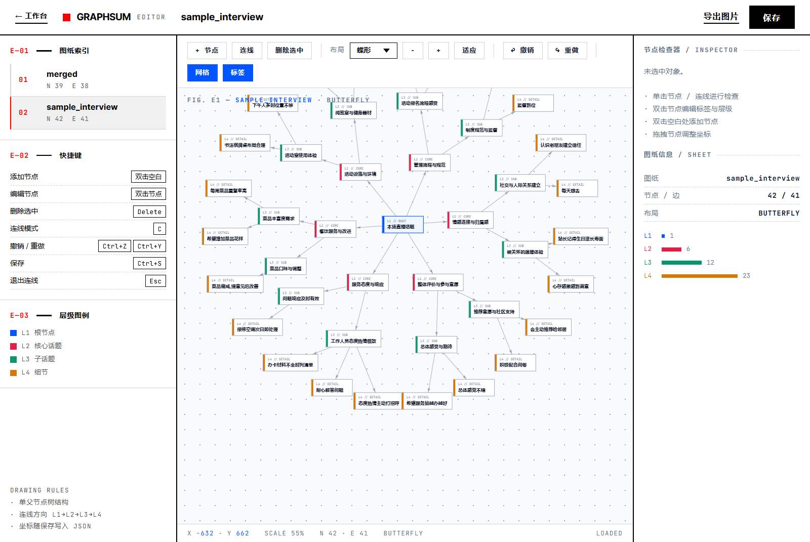

# GraphSum — Interview Text → Hierarchical Knowledge Graph

[中文](README.md)

LLM-driven toolkit that turns interviews and documents into 4-level knowledge graphs: multi-format input → entity extraction → multi-document merge → Flask web coding UI. Built for qualitative research coding, business-interview knowledge capture, and knowledge-base structuring.



*The graph above was extracted from a fully synthetic sample (`examples/sample_interview.txt`) via a real LLM API.*

## Features

- **Multi-format input**: `.docx` (tables included), `.doc`, `.txt`, `.md`, `.json`, `.ass`, `.srt`
- **Provider-agnostic**: any OpenAI-compatible API, configured via environment variables; no keys in the repo
- **4-level hierarchy**: topic → category → manifestation → description, strict single-parent tree, configurable per-level node caps
- **Long-text chunking** with overlap and result merging
- **Two-stage preprocessing**: rule-based noise filtering + optional reranker scoring for noisy subtitles
- **Multi-document merge**: per-level AI semantic merging with dedup and node caps
- **Web UI**: upload, batch generation, SSE progress, task cancellation, provider/prompt switching, graph editor (JSON editing + re-render)
- **Layouts**: radial and butterfly, overlap avoidance, crossing detection, unit-tested
- **Explicit failure**: extraction errors raise instead of fabricating a preset graph

## Quick Start

```bash
python -m venv .venv
# Windows: .venv\Scripts\activate   Linux/macOS: source .venv/bin/activate
pip install -r requirements.txt

cp .env.template .env   # fill in your own API key
python app.py           # open http://127.0.0.1:5001
```

Upload `examples/sample_interview.txt` (or the `.docx` version) in the web UI, pick a provider and prompt template (default `interview`), and generate to reproduce the sample graph.

CLI mode: `python interview_graph_generator.py` (1 = single doc, 2 = batch). Put `.docx` files in `data/` or set `TEST_FILE_PATH`. Outputs: `*_graph.png` + `*_graph.json`.

## Configuration

Everything lives in `.env` (gitignored). Provider format: `PROVIDER_{NAME}_API_KEY / _BASE_URL / _MODEL`, extensible to any OpenAI-compatible service; the template ships an OpenAI example (`https://api.openai.com/v1` + `gpt-4o-mini`) by default. Optional: `SECRET_KEY`, reranker settings (`ENABLE_RERANKER_PREPROCESS`, `RERANKER_*`), node caps (`DEFAULT_MAX_LEVEL2/3/4_NODES`), `FLASK_DEBUG` (off by default; server binds 127.0.0.1).

## Web UI & Editor









The `/editor` page edits graph JSON (nodes/edges/labels) and re-renders the PNG with one click — useful for manual coding corrections.

## Tests

```bash
python -m unittest discover -v
```

Covers crossing-free layout, explicit extraction failure, graph cleaning, chunking, merge dedup, and preprocessing rules. No API key required.

## Privacy

Uploaded files and generated graphs are stored locally. Text used for extraction and merging is sent to the selected model provider. If a remote reranker is enabled, it also receives the candidate text.

The repository contains only tool code and synthetic samples. `data/`, `logs/`, and `.env` are gitignored; no real interview data is included. Failed extraction raises an error rather than emitting a fabricated graph.

## License

[MIT](LICENSE)

Bundled third-party licenses: [Inter](licenses/Inter-OFL.txt) · [JetBrains Mono](licenses/JetBrains-Mono-OFL.txt) · [vis-network](licenses/vis-network-MIT.txt)